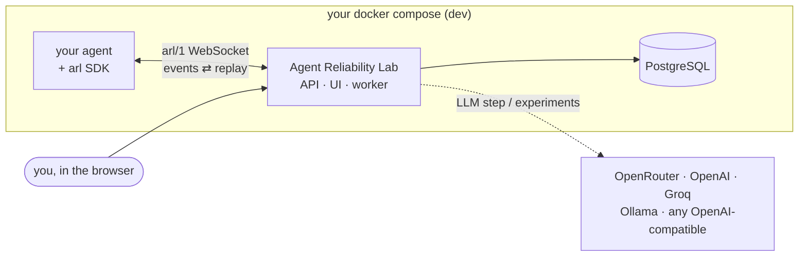
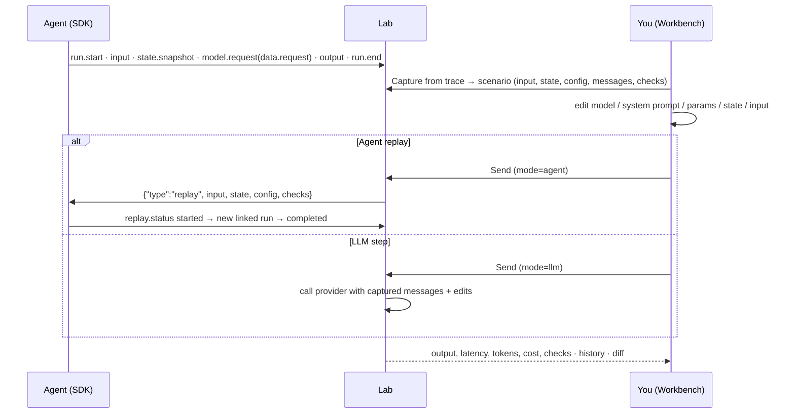

# Agent Reliability Lab

**Postman + live tracing for AI agents, running next to your code.**
Add one container to your development `docker compose`, add a few SDK calls to
your agent, and you get:

- **Live traces** of every run — input, retrieved context, knowledge-graph walks,
  agent loop, LLM requests/responses, tool calls, cost, checks — streamed over one
  WebSocket while you develop.
- **Workbench** — capture a run's *functional state* (input, state snapshot, model,
  system prompt, parameters) as a scenario, edit anything, and **send it again**:
  as a full agent replay executed by your own code, or as a single LLM step the lab
  calls directly. Every run is stored for side-by-side comparison with a word diff.
- **Experiments** — benchmark models on datasets with seeded schedules, retries,
  budgets, scorers/judges, confidence intervals, paired comparisons and reports.

The SDKs are no-ops outside `STAGE=dev`, so the instrumentation stays in your code
and costs nothing in production.



## Quick start

```bash
git clone https://github.com/VicoAritonang/lab-of-night-and-flame.git
cd lab-of-night-and-flame
docker compose up -d            # → http://localhost:8000
```

Try the complete loop with the example agent (no API key needed — it falls back
to a mock model):

```bash
docker compose -f examples/compose/docker-compose.yml up -d --build
# open http://localhost:8000/workbench → "Capture from trace" → edit model or prompt → Send
```

## Add it to your project

1. **Add the lab to your compose file** (copy the `arl` and `arl-db` services from
   [docker-compose.yml](docker-compose.yml), or use `include:`), and give each agent:

   ```yaml
   environment:
     LAB_WS_URL: ws://arl:8000/api/agent-lab/ws
     STAGE: dev
   ```

   A full layout is in [examples/compose/docker-compose.yml](examples/compose/docker-compose.yml).
   Agents running on the host use `ws://localhost:8000/api/agent-lab/ws`.

2. **Instrument the agent** with an SDK:

   | Language | Install | Docs |
   | --- | --- | --- |
   | Python | `pip install arl-lab` | [sdk/python](sdk/python/README.md) |
   | TypeScript / JS | `npm install arl-lab` | [sdk/typescript](sdk/typescript/README.md) |
   | Go | `go get github.com/VicoAritonang/lab-of-night-and-flame/sdk/go` | [sdk/go](sdk/go/README.md) |
   | Anything else | JSON over WebSocket | [connection.md](connection.md) |

   ```python
   from arl_lab import Lab

   lab = Lab("support-agent")

   def answer(question, config):
       with lab.run("Support question") as run:
           run.input(question)
           run.snapshot(state={"memory": memory}, config=config)    # what a replay needs
           request = {"model": config["model"], "messages": [
               {"role": "system", "content": config["system_prompt"]},
               {"role": "user", "content": question}]}
           reply = llm(request)
           run.model_call(request, reply)                           # re-sendable LLM step
           run.output(reply)
           return reply

   @lab.on_replay                      # Workbench → your code, with edited values
   def replay(r):
       answer(r.input_text(), {"model": r.model(DEFAULT_MODEL),
                               "system_prompt": r.system_prompt(DEFAULT_PROMPT)})

   lab.connect(wait=30)
   ```

3. **Use the UI**: *Agent lab* shows live traces; *Workbench* turns any trace into
   an editable scenario (`Open in Workbench` on a trace, or *Capture from trace*).

## The Workbench flow



Scenarios are grouped into collections and can be exported/imported as JSON
(`arl-workbench/1`) to share with your team or keep in the repository.

## Configuration

| Variable | Default | Purpose |
| --- | --- | --- |
| `ARL_DATABASE_URL` (`NEON_DB_URL`) | — | PostgreSQL URL (compose sets it) |
| `ARL_AUTO_MIGRATE` | `true` in image | Apply [sql/init.sql](sql/init.sql) at startup (idempotent) |
| `ARL_LISTEN_ON_START` | `true` in image | Accept agents immediately |
| `ARL_EMBEDDED_WORKER` | `true` without SQS | Run jobs in process |
| `ARL_SERVE_UI` | `true` | Serve the web UI on `/` |
| `ARL_AUTH_TOKEN` | empty | Protect the UI/API/WebSocket; agents send `LAB_TOKEN` |
| `OPENROUTER_API_KEY`, `OPENAI_API_KEY`, `GROQ_API_KEY`, `ARL_LOCAL_BASE_URL` | empty | Providers for LLM steps, Playground and experiments (`fake` always works) |

The lab binds to `127.0.0.1` in the provided compose files. Set `ARL_AUTH_TOKEN`
before exposing it beyond your machine. Larger shared deployments (EC2 + Lambda/SQS +
Neon + Vercel) are described in [DEPLOYMENT.md](DEPLOYMENT.md).

## Development

```bash
# Backend (Go 1.26). Integration tests need an isolated PostgreSQL:
go test ./...
ARL_TEST_DB_URL='postgres://postgres@localhost:5432/arl_test?sslmode=disable' go test -p 1 ./...

# UI with hot reload (proxies /api to :8000)
cd frontend && npm ci && npm run dev

# SDKs
(cd sdk/go && go test ./...)
(cd sdk/python && pip install -e ".[test]" && pytest)
(cd sdk/typescript && npm install && npm test)
```

Repository layout: `main.go` (server), `internal/` (engine, tracing, workbench,
providers, storage), `web/` (embedded UI), `frontend/` (React UI), `sdk/` (Go,
Python, TypeScript), `examples/`, `sql/`, `cmd/` (worker, Lambda, admin, packager).

See [CONTRIBUTING.md](CONTRIBUTING.md) and [SECURITY.md](SECURITY.md).

## Roadmap

- OpenAI-compatible capture proxy (point `base_url` at the lab, zero code changes)
- OpenTelemetry GenAI span import
- Batch-run a collection against a model matrix from the Workbench
- Workbench scenarios as CI regression tests (`arl test collection.json`)

## License

[Apache-2.0](LICENSE)
